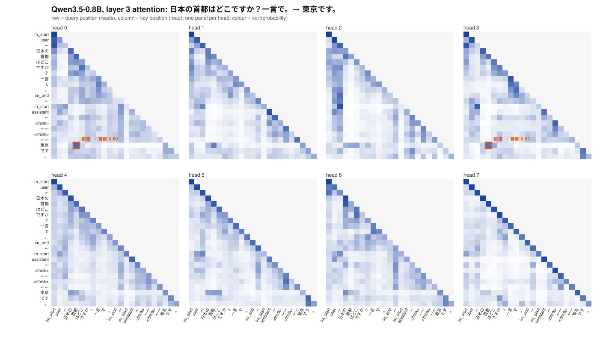

# Qwenを理解するRust推論器



実重みのQwen3.5-0.8Bが「日本の首都はどこですか？一言で。」に「東京です。」と答えたときの、層3（最初のAttention層）の8ヘッド分のAttention確率です。
行が読む側の位置、列が読まれる側の位置です。答えの「東京」を出す位置が、質問の「首都」を0.60の重みで読んでいます（オレンジ枠）。
この図はトレースから描いています（[描き方](#トレースと介入)）。

1トークンが生成されるまでを、自分のコードで説明・検証するためのRust推論器です。
固定revisionのQwen3.5-0.8B公開重みで、テキスト経路を公式実装と照合しました。
**CPU版が基準**（教材であり正解）で、Apple GPU（Metal）版とAMD GPU（ROCm）版は同じRustエンジンを共有し、CPU版との一致で検証します。
推論はRustだけで行います。Pythonは公式ソースからの比較fixture生成と、図を描く補助スクリプトだけです。

## できること

- **中を見る**：Q/K/V・Attentionのスコアと確率・DeltaNetの状態・FFNの中間値・残差・logitsをNDJSONで記録できます。会話中も位置を指定して記録できます。
- **介入する**：FFNのユニットを消す、ある方向の成分を除く、といった重みへの介入を、生成や会話の途中で付け外しできます（元の重みは不変）。
- **会話する**：複数ターンの会話、保存と再開（CPU版とGPU版で同じファイル）、長いsystem文書を一度だけ計算して再利用するキャッシュ。
- **検証する**：公式実装と最大711位置で照合。GPU版は全層・全状態をCPU版と照合し、長文脈は8192トークンまで確認しています。
- **速く動かす**：Apple M5のGPUでdecode約66 token/s、約1万トークンのprefillが18秒（1回測定）。

| | CPU | Metal（Apple GPU） | ROCm（AMD GPU） |
|---|---|---|---|
| 推論・生成 | ✓（基準） | ✓（M5で検証） | 実装のみ・実機未検証 |
| 会話・保存と再開・systemキャッシュ | ✓ | ✓（ファイル共通） | 実装のみ |
| 重み介入 | ✓ | ✓ | 実装のみ |
| トレース | 全演算 | 層ごとの出力（mixer内部はCPU版のみ） | 実装のみ |
| sampling | greedy・seed固定 | `infer` はgreedy、`chat` はseed固定も可 | 同左 |
| decode速度（参考） | 約2.6 token/s | 約66 token/s（M5） | 未測定 |

## すぐ試す

```sh
tools/download-model.sh ./models/qwen          # 公開重み約1.75GB（明示的に実行したときだけ取得）
cargo run --release --offline --locked -- chat --model-dir ./models/qwen

# Apple Silicon Macなら GPU 版（Xcode不要）
bash tools/build-metal.sh
cargo build --release --offline --locked --features metal
./target/release/qwen-rust-inference metal-chat --library target/metal/libqwen_metal.dylib --model-dir ./models/qwen
```

コードを読むなら、まず [コードの読み方と手計算例](spec/learning.md) を参照してください。
[保存トレースを読む8問の演習](spec/exercises.md) と [解答](spec/exercise-solutions.md) も用意しています。
AttentionのGQA・位置回転、DeltaNetの状態更新、FFNの書込み列には日本語の学習用コメントがあります。

## 教育用デモとオフラインテスト

Rust 1.85.1（rustfmt・clippy）とC/C++ツールチェーンが必要です。
依存はCargo.lock・vendorに固定。ツールチェーン準備後はネットワーク・実重み・Pythonなしで動きます。
デモの小型モデルは合成重みで、文章の意味を学習したものではありません。

```sh
cargo run --offline --locked -- demo ffn --unit 3
cargo run --offline --locked -- demo attention --cache
cargo run --offline --locked -- demo deltanet
cargo run --offline --locked -- demo lesson --trace /tmp/lesson.ndjson
cargo run --offline --locked -- demo hybrid --max-new-tokens 8
cargo fmt --check
cargo clippy --offline --locked --all-targets -- -D warnings
cargo test --offline --locked
```

FFNは幅8・中間幅16。ハイブリッドデモは幅8、DeltaNet×3＋Attention×1です。
`Backend::Reference` の明示ループとsgemmを残し、通常推論は検証済みの単一ベクトル用 `Vector` を使います。
[初期の選定理由](spec/adr-0002.md)・[実用性改善のADR](spec/adr-0003.md) と [依存ライセンス](spec/dependencies.md) を記録しています。

## 公開重みでテキスト推論

通常テストではダウンロードしません。以下の**明示コマンド**だけが外部取得します。
重み約1.75GB、読み込んだ言語部f32重みと一時バッファに数GBのRAMが必要です。
CPU版は短い文脈・少数生成トークン向けです（decode約2.6 token/s）。長い文脈はGPU版を使ってください。

```sh
tools/download-model.sh ./models/qwen
cargo run --release --offline --locked -- inspect-config --model-dir ./models/qwen
cargo run --release --offline --locked -- infer --model-dir ./models/qwen --ids 16,10,16,28 --max-new-tokens 8
cargo run --release --offline --locked -- infer --model-dir ./models/qwen --prompt '1+1は？' --max-new-tokens 16
cargo run --release --offline --locked -- infer --model-dir ./models/qwen --prompt 'Hello' --max-new-tokens 8 --seed 42 --temperature 0.8 --top-k 40
```

`infer --prompt` は単一userメッセージのtext-only chat templateを使います。
`--raw` はテンプレートなし、`--thinking` は思考開始付きです。
複数ターンやsystemメッセージには後述の `chat` を使います。ツール・画像入力は未対応です。
終了は `<|im_end|>` とendoftext、または生成数/文脈上限。`</think>`では終了しません。
seed固定samplingの乱数はこのRust実装のLCGであり、PyTorchのsampling列との一致は保証しません。

確認例：`1+1は？`、生成上限8で `1+1 は **2** です` を出力しました。
文の自然さではなく、[実モデルの演算別検証結果](spec/validation-real.json) を正しさの根拠にしています。
初期の演算別検証では3入力・計9位置、全24層を比較し、logits最大絶対誤差は約3.53e-5、全比較最大は約6.29e-5でした。
BF16重みを両実装ともf32へ変換した比較であり、BF16ネイティブ計算との比較ではありません。

## トレースと介入

トレースはデフォルト無効で、外部送信しません。指定された新規ファイルへNDJSONを書き、既存ファイルを上書きしません。
Q/K/V・スコア・確率・ゲート・FFN中間値・DeltaNet状態・残差・logits上位候補を観測できます。
`infer` は1位置、`chat` は `--trace-position N,M,...` や `/trace N`・`/trace +K` で指定した絶対位置を、計算されるたびに記録します。
配列はフラットなf32ビューとしてshapeを記録します。多軸の格納規約は[対応表](spec/tensors.md)と各型を参照してください。

```sh
cargo run --offline --locked -- demo ffn --trace /tmp/ffn.ndjson --trace-full
cargo run --release --offline --locked -- infer --model-dir ./models/qwen --ids 16,10,16,28 --max-new-tokens 1 --trace /tmp/qwen.ndjson --trace-layer 3 --trace-position 0 --trace-max-bytes 65536
```

実モデルで `--trace-full` を使う場合、対象層・対象位置・バイト上限をすべて明示してください。
最終logits全配列も記録するため、十分な上限が必要です。上限超過は次のレコードを書かずエラーになります。
出力済みレコードはファイルに残ります。トレースは入力内容を推測できる情報を含むため、保存先を管理してください。
Rust APIの `Model::prefill` は観測用に全stepの活性値を返します。大量位置には使わず、
通常生成は `generate` で各stepの活性値を解放してください。

冒頭の図は、`chat` で全位置をトレースし、Python標準ライブラリだけのスクリプト（`tools/plot_attention.py`）でSVGにしたものです。

```sh
cargo run --release --offline --locked -- chat --model-dir ./models/qwen \
  --prompt '日本の首都はどこですか？一言で。' --max-new-tokens 6 \
  --trace /tmp/l3.ndjson --trace-position $(seq -s, 0 39) --trace-layer 3 \
  --trace-max-bytes 400000000 --trace-full --save-state /tmp/l3.qrs
python3 tools/plot_attention.py /tmp/l3.ndjson --layer 3 --snapshot /tmp/l3.qrs \
  --tokenizer models/qwen/tokenizer.json --mark 0:20:4 --mark 3:20:4 -o /tmp/attention.svg \
  --title 'Qwen3.5-0.8B, layer 3 attention: 日本の首都はどこですか？一言で。→ 東京です。'
```

軸のトークン名はsnapshotのトークン列と `tokenizer.json` から復元します。色は確率の平方根で、小さな重みも見えるようにしています。
位置ごとにlogits全体（約2.5MB）も記録されるので、トレースは約70MBになります。

```sh
cargo run --release --offline --locked -- infer --model-dir ./models/qwen --ids 16,10,16,28 --max-new-tokens 4 --edit examples/zero-unit.json --compare-edit
cargo run --release --offline --locked -- infer --model-dir ./models/qwen --ids 16,10,16,28 --max-new-tokens 4 --edit examples/remove-coordinate-direction.json --compare-edit
```

編集manifestはモデルrevision・ゼロ始まりの層・完全tensor名・列・方向・係数を保存します。
元重みは不変で、ユニット無効化と方向成分除去は活性値/出力差分のoverlayです。
比較時はFFN・残差・logitsの差と、生成列の反復トークン/二連続組の再出現数を表示します。
例の方向は第0座標で、意味的な反復方向を発見したものではありません。
研究記事のループ抑制や性能向上の再現は未実施です。
`chat` では `--edit` で開始し、`/edit PATH`・`/edit off` で会話の途中に付け外しできます。
変えると同じトークン列を新しい介入で計算し直すので、キャッシュに2種類の介入が混ざりません。介入は保存ファイルにも記録されます。

## 固定参照とfixture再生成

モデル・重み・tokenizer・テンプレートは `2fc06364715b967f1860aea9cf38778875588b17`、
Transformersは `a6f5c8676b158c367dc3389f68dde7a97fb619d6`。
[参照lock](spec/references.lock.json) にGit/LFS識別子と同梱資料のSHA-256があります。

公式クラス/関数本文をASTで抽出し、型注釈と任意カーネルラッパーを外してCPU PyTorchで実行します。
クラスの数式本文は変更しません。動的キャッシュの格納だけを小さな比較用アダプタで提供します。
Rustには公式chunk式を移植せず、参照側のchunk prefillと逐次decodeの両方を比較します。
実モデルfixtureではメモリを抑えるため再帰状態全量を省き、小型fixtureでは全stepを保存します。

```sh
python3.12 -m venv .venv
.venv/bin/pip install --extra-index-url https://download.pytorch.org/whl/cpu -r tools/requirements-reference.lock
.venv/bin/python tools/generate_fixtures.py
.venv/bin/python tools/generate_hybrid.py
(cd tests/fixtures && sha256sum -c SHA256SUMS)
cargo test --offline --locked
# 実モデル統合検証はopt-in（通常CIではignore）
.venv/bin/python tools/generate_hybrid.py --model-dir models/qwen
cargo test --release --offline --locked --test real_model -- --ignored --nocapture
```

ファイルハッシュ再現環境はPython 3.12.14 / Linux x86_64 / CPU PyTorch 2.6.0。
入力・重み・版・生成条件・誤差基準・生成器hashをfixtureに保存します。
実モデルの大きいfixtureと重みはGitに入れません。通常CIは同梱した小型fixtureを読みます。

## 仕様・制限

- [Phase 0・1の演算仕様](spec/phase-01.md) / [Phase 2〜6の仕様と許容誤差](spec/phase-02-06.md)
- [形状・tensor名・参照対応表](spec/tensors.md)
- [進捗・実行した検証・残る制限](spec/progress.md)

対応は単一バッチのテキストです。CPU版は短い文脈向けで、長い文脈はGPU版（Metalは検証済み、ROCmは実機未検証）を使います。
量子化（値が変わる形式）、画像・動画、MTP、学習、分散、投機的decode、Web UI、研究性能の再現は対象外です。
実モデルの別revision・別アーキテクチャ・別dtype・別RoPEは受け入れません。
演算エラーで中断したModelStateは再利用せずresetしてください。

Apache-2.0。参照資料・依存の著作権とライセンスは [NOTICE](NOTICE) とvendor内に保持しています。

## 32・128・512トークンへの検証拡大

[検証仕様と実行手順](spec/extended-validation.md) に、全位置の24層出力と全語彙logits、
各prefill後の8位置の継続decode、全層の状態、自然なEOS終了を照合するopt-in検証を追加しました。
参照値はストリーム読みのf32バイナリで、通常CIのネットワーク・モデル不要という条件を保ちます。

```sh
.venv/bin/python tools/generate_extended.py --model-dir models/qwen
cargo test --release --offline --locked --test extended_real -- --ignored --nocapture --test-threads 1
```

長い入力は `Model::prefill_observed` で処理し、全stepの活性値を保持しません。
保存した [教材トレース](examples/lesson-trace.ndjson) と [数値解答](examples/lesson-answers.json) は
小型の合成モデルによるもので、Rustだけで再生成できます。

検証は合格し、[測定結果](spec/validation-extended.json) を保存しました。
継続decodeを含む696位置と自然なEOS生成の15予測位置、計711位置を比較し、
logitsの最大絶対誤差は約6.48e-5でした。詳細な範囲と相対誤差の読み方は検証仕様を参照してください。

## 複数ターン・保存と再開・速度計測

```sh
cargo run --release --offline --locked -- chat --model-dir models/qwen
# /continue /reset /save /tmp/chat.qrs /load /tmp/chat.qrs /quit

cargo run --release --offline --locked -- chat --model-dir models/qwen --prompt '数字だけで答えてください。1+1は？' --max-new-tokens 1 --save-state /tmp/partial.qrs
cargo run --release --offline --locked -- chat --model-dir models/qwen --load-state /tmp/partial.qrs --continue --max-new-tokens 16 --save-state /tmp/complete.qrs
cargo run --release --offline --locked -- chat --model-dir models/qwen --load-state /tmp/complete.qrs --prompt 'その数に1を足すと？数字だけ答えてください。' --max-new-tokens 16

cargo run --release --offline --locked -- bench --model-dir models/qwen --backend vector --decode-steps 8 --warmup 1 --runs 2 > /tmp/bench.json
```

実測例は、保存前「1」→再開「1+1=2」→次ターン「2+1=3」。
[実用性の仕様・全オプション](spec/practical.md) と [実モデル検証](spec/measurements/chat-resume.json) を参照してください。
`chat` はモデルを一度ロードして会話を続けます。`--system`/`--thinking`/seed固定samplingに対応し、
再開時には保存した設定を使います。過去assistantの思考部分が公式テンプレートで省かれるため、
一致するuser末尾のanchorへ戻り、必要な部分を再計算します。常に全cacheを盲目的に追記しません。
systemメッセージ（`--system` または `--system-file`）は最初に単独でprefillし、以後のターンと `/reset` で再利用します。
その直後に保存したファイルは長い文書のキャッシュになります。会話中の重み介入（`/edit`）とトレース（`/trace`）は[トレースと介入](#トレースと介入)を参照してください。
保存ファイルはGPU版（`metal-chat`・`rocm-chat`）と共通です。

この環境の[計測結果](spec/measurements/cpu-baseline-vector.json)では平均decodeが約1.23→2.64 token/s、
ロードを含むピークRSSが約5.78→4.76GBでした。warmup 1回・測定2回の短い固定入力による観測です。
単一ベクトル向けCPU演算を追加し、巨大配列の共有時コピーと観測用コピーを省きました。
[711位置の参照検証](spec/validation-vector.json)も既存の誤差基準で合格しています。

snapshotは重みを含まず、KV/再帰/畳み込み状態、logits、pendingトークン、RNG、会話とanchorを保存します。
同じmodel-dirが必要で、別プロセスではモデルのロード時間が再び掛かります。
保存は明示opt-in、ローカルのみ、既存ファイルの上書きなし、デフォルト上限256MiB。
会話を含む平文/数値データで暗号化はしません。モデル・形状・version・checksumの不一致を拒否します。
weightsは読み取り専用のModel APIで扱い、編集は別overlayを使います。

## 実験用Metal（Apple Silicon / macOS 15+）

任意機能 `--features metal` とObjective-C++のMetalブリッジで、ROCm版と同じRust側エンジン
（`src/device.rs`）をApple GPUで動かします。Command Line Toolsだけでビルドでき、Xcodeは不要です。
Apple M5で小型fixture・実重みの全層比較に合格し、生成結果がCPU版のgreedy出力と一致しました。

```sh
bash tools/build-metal.sh
cargo build --release --offline --locked --features metal
./target/release/qwen-rust-inference metal-check --library target/metal/libqwen_metal.dylib
./target/release/qwen-rust-inference metal-infer --library target/metal/libqwen_metal.dylib \
  --model-dir models/qwen --prompt '1+1は？' --max-new-tokens 32
```

行列は配布形式のBF16のまま（値は変えずに）GPUに置き、prefillは最大128トークンずつまとめて計算します。
Attentionの読出しもチャンク単位で、Apple GPUの行列演算命令を使って計算します。
M5での1回測定では、454トークンの入力でprefill約750 token/s・decode約66 token/s、
約1万トークンの入力でもprefill 18秒・decode約50 token/sでした（[記録](spec/measurements/metal-m5-attention.json)、
[decodeの記録](spec/measurements/metal-m5-norm.json)）。
長文脈では8192トークンまでCPU版と全状態を照合しています
（[長文脈の記録](spec/measurements/metal-m5-long.json)、`metal-check --text-file … --tokens N`）。
CPU版と同じ編集manifest（`--edit`、`--compare-edit`）と、1位置分の層ごとのトレース（`--trace … --trace-position N`）も使えます。
AttentionやDeltaNetの内部はCPU版のトレースだけにあります。

`metal-chat` はCPU版 `chat` と同じ会話・コマンド・snapshotファイルをGPUで扱います。
GPUで保存した会話をCPUで再開することも、その逆もできます。
systemメッセージは最初に1回だけprefillして巻き戻し点として残すので、長い文書をsystemに入れて保存すれば
「トークンキャッシュ」になります（2637トークンのprefill 3.6秒 → 読込0.24秒、[記録](spec/measurements/metal-m5-chat.json)）。

```sh
./target/release/qwen-rust-inference metal-chat --library target/metal/libqwen_metal.dylib \
  --model-dir models/qwen --system-file 長い文書.txt --save-state /tmp/doc.qrs </dev/null
./target/release/qwen-rust-inference metal-chat --library target/metal/libqwen_metal.dylib \
  --model-dir models/qwen --load-state /tmp/doc.qrs --prompt 'この文書を要約して' --stats
```

DeltaNetの状態は全トークンを吸収した固定サイズの行列なので、KVのように任意の位置で切り戻せません。
そこで巻き戻す場所（system末尾と直前のuser末尾）だけでDeltaNet状態（約19MiB）を控えます（[ADR 0011](spec/adr-0011.md)）。
会話中も `--edit`・`/edit PATH|off`（履歴を新しい介入で計算し直す）と、絶対位置のトレース（`--trace-position N,M`、`/trace +K`）が使えます。
どちらもCPU版 `chat` に同じ形であり、CPU版のトレースにはAttention・DeltaNetの内部まで入ります。
`infer` はgreedy・単一run、`chat` はseed固定samplingも使えます。手順と設計は[spec/metal.md](spec/metal.md)、
[ADR 0005](spec/adr-0005.md)、[ADR 0006](spec/adr-0006.md)、[ADR 0007](spec/adr-0007.md)、[ADR 0008](spec/adr-0008.md)、[ADR 0009](spec/adr-0009.md)、
[ADR 0010](spec/adr-0010.md)、[ADR 0011](spec/adr-0011.md)を参照してください。

## 実験用ROCm（RX 7900 XTX / WSL2）

任意機能 `--features rocm` とHIP/rocBLASブリッジで、Metal版と同じRust側エンジンをAMD GPUで動かす経路です。
通常のCPUビルドにはROCmは不要です。
**GPUでのコンパイル・実行・性能は未検証**です。CPUテストブリッジでの算術検証と区別してください。

[WSL設定・ビルド・実機比較・生成の手順](spec/rocm.md)に従い、
`rocm-check`で小規模→実重みの順に検証してから`rocm-infer`・`rocm-chat`を実行してください。
BF16重みとまとめてprefill（ADR 0006、0007）、重み介入とトレース（ADR 0010）、会話と保存/再開（ADR 0011）は
Metal版とコードを共有しますが、ROCm実機では未検証です。
