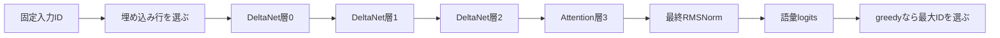

# 演習：保存トレースから次の1トークンを説明する

所要時間の目安は45〜90分です。実モデル重みもPythonも不要です。
まず問題の答えを紙かメモに予測し、トレースで確認してください。
[解答と理由](exercise-solutions.md) は最後に読みます。

## 準備：何を観測するか

この教材は未学習の合成モデルです。幅8、中間幅16、DeltaNet×3＋Attention×1、語彙19。
入力IDを `[1,4,2]` に固定しています。次のIDをモデルに選ばせる生成とは区別してください。



各層の内部は `input norm → Mixer → 残差 → post norm → FFN → 残差` です。
[保存済みNDJSON](../examples/lesson-trace.ndjson) は330行で、各行に1つの演算結果があります。
[数値解答JSON](../examples/lesson-answers.json) は要点だけを抜き出しています。
これらは利用者の入力を含まず、教材用の既知IDと合成重みのみです。

生成し直す場合は新しい保存先を使います（既存ファイルは上書きしません）。

```sh
lesson_dir=$(mktemp -d)
cargo run --offline --locked -- demo lesson --trace "$lesson_dir/trace.ndjson" > "$lesson_dir/answers.json"
```

以降の抽出例はjqを使います。`values` は最後の軸が連続するフラット配列です。
多軸の対応は [tensors.md](tensors.md) にあります。

## 問1：入力IDとモデルの予測は同じか

位置0の入力IDは1です。embeddingと層0のinputを見てください。

```sh
jq 'select(.token_position==0 and .layer==0 and (.operation=="embedding" or .operation=="input")) | {operation,values}' examples/lesson-trace.ndjson
```

1. 2つの配列は同じですか。長さはいくつですか。
2. 位置0のgreedy予測が10なのに、位置1の入力IDが4なのはなぜですか。
3. token ID 10を、この教材から日本語の単語へ変換できますか。

対応コード: `model.rs::step`、`lesson.rs::write_lesson`。

## 問2：正規化は残差の値を置き換えるか

位置0・層0のinput、input_norm、mixer、after_mixerを抽出します。

```sh
jq 'select(.token_position==0 and .layer==0) | .operation as $op | select(["input","input_norm","mixer","after_mixer"]|index($op)) | {operation,values}' examples/lesson-trace.ndjson
```

1. `after_mixer[0]` は input[0]+mixer[0] と input_norm[0]+mixer[0] のどちらですか。
2. FFN後の `layer[0]` は何と何の和ですか。
3. RMSNormの保存重みが0なら、その成分の係数は0ですか、1ですか。
4. RMSNorm後の値のL2ノルムは必ず1になりますか。

対応コード: `block.rs::step`、`ops.rs::rms_norm`。

## 問3：一つのFFNユニットはどこへ書くか

位置0・層0・unit 3について調べます。

```sh
jq 'select(.token_position==0 and .layer==0 and (.operation=="ffn.product" or .operation=="lesson.ffn.column_3" or .operation=="lesson.ffn.removed_write")) | {operation,values}' examples/lesson-trace.ndjson
```

1. unit 3の反応値はいくつですか。
2. down列3の第0成分を掛け、unit 3を消したときの出力第0成分の減少を予測してください。
3. 8成分すべての差分は `反応値 × down列3` と一致しますか。
4. down行3を取り出すと、なぜ同じ意味にならないのですか。

対応コード: `ffn.rs::writing_vector`、`forward`。実験はFFNの同じ入力同士で比較しています。

## 問4：Attentionの「過去を読む確率」を復元する

位置1・層3のhead 0に注目します。scoresの最初の2成分がhead 0の2位置分です。

```sh
jq 'select(.token_position==1 and .layer==3 and (.operation=="attention.q" or .operation=="attention.scores" or .operation=="attention.probabilities" or .operation=="attention.context")) | {operation,values}' examples/lesson-trace.ndjson
jq 'select(.layer==3 and .operation=="attention.k") | {token_position,values}' examples/lesson-trace.ndjson
jq 'select(.layer==3 and .operation=="attention.v") | {token_position,values}' examples/lesson-trace.ndjson
```

1. `dot(Q_head0,K_position)/sqrt(4)` を各過去位置について計算し、scoresを確認してください。
2. softmaxの確率は約0.45035434と0.54964566です。和と大小関係は何を意味しますか。
3. 2つのVの第0成分をこの確率で加重平均し、context[0]を求めてください。
4. Qが2ヘッドでKVが1ヘッドのため、head 1はどのK/Vを使いますか。
5. 位置0のhead 0の確率が必ず `[1]` なのはなぜですか。

対応コード: `attention.rs::attend_traced`。Q/KはすでにnormとRoPEを適用済みです。

## 問5：DeltaNetは差分をどこへ記憶するか

位置0・層0・head 0・S[0,0]だけを手計算します。

```sh
jq 'select(.token_position==0 and .layer==0 and (.operation=="delta.k" or .operation=="delta.v" or .operation=="delta.beta" or .operation=="delta.decay_log" or .operation=="delta.recurrent_state")) | {operation,values}' examples/lesson-trace.ndjson
```

1. 初期Sがゼロのとき、memory=k^T Sはいくつですか。
2. `k[0]=-0.4287088`、`v[0]=-0.002049082`、`beta[0]=0.6026434`から新しいS[0,0]を求めてください。
3. 初回stepではgを変えるだけでSの結果は変わりますか。他の値は同じとします。
4. 位置1では、`S ← exp(g)S` を省くと何が変わりますか。
5. y=q^T Sに渡すqは、head_dimでスケール済みですか。

対応コード: `deltanet.rs::delta_rule`。stateは[head,key_dim,value_dim]の順です。

## 問6：増える記憶と固定サイズの記憶を数える

```sh
jq '.steps[]|{position,kv_positions,convolution_elements,recurrent_elements}' examples/lesson-answers.json
```

1. 位置0・1・2のKVの位置数を予測してください。
2. DeltaNetの再帰状態は、全3層で何要素ですか。式も書いてください。
3. 畳み込み履歴のチャンネル数はQ/K/Vを合わせて24です。kernel=3のとき、全3層で何要素ですか。
4. 入力を100位置に延ばすと、どの値が増えますか。

対応コード: `state.rs`、`deltanet.rs::new_state`。

## 問7：logitsから次のIDを説明する

```sh
jq 'select(.token_position==0 and (.operation=="final_norm" or .operation=="logits")) | {operation,values,logits_top}' examples/lesson-trace.ndjson
```

1. 最終正規化ベクトルと埋め込み行10の内積を計算し、logits[10]と比べてください。
2. logits[10]は確率ですか。greedyにsoftmaxは必要ですか。
3. 語彙射影にdown行列を再利用しないのはなぜですか。
4. 自己回帰に切り替えると、次の入力とKV/再帰状態をどう扱いますか。

対応コード: `model.rs::step`、`generate.rs::decode_with`。

## 問8：最初の乖離位置から不具合を切り分ける

次の症状について、最初に確認する演算・配列規約を挙げてください。

- embeddingは一致するがinput_normから違う。
- 位置0は一致し、過去ありのAttentionだけが違う。
- FFNのgate/up/productまで一致し、down出力から違う。
- 64位置の前後で初めて公式prefillとの違いが大きくなる。
- `</think>`を出した直後に回答が止まる。

許容誤差を広げる前に、入力・dtype・層番号・位置offset・最初の不一致を確認します。

## 演習の検算

```sh
cargo test --offline --locked --test lesson
cargo test --offline --locked --test streaming
```

教材の残差、FFN差分、AttentionのsoftmaxとV加重和、DeltaNetの再帰更新、
最終語彙射影を、保存配列からf64で独立に組み直して照合します。
再生成物との一致も誤差付きで検証し、CPU環境による最下位bitの差を許容します。

次に [長い実モデル検証](extended-validation.md) の手順で、同じ観測点を
本物のQwen3.5-0.8Bへ広げてください。通常CIはモデルを取得しません。
